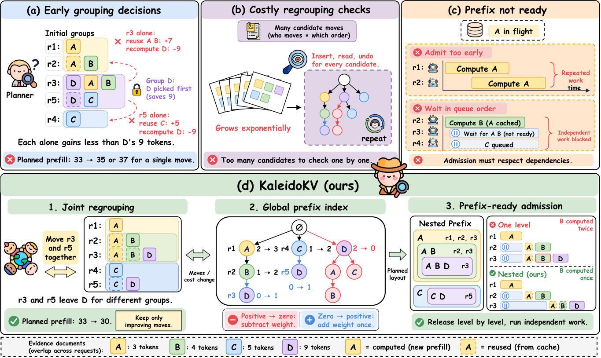

# KaleidoKV: Rearranging Evidence for Efficient KV Cache Reuse in Offline RAG Inference

<a href="KaleidoKV_Supplementary_Material_Appendix.pdf">
  
</a>

## 📄 Abstract

Retrieval-augmented generation (RAG) augments large language models (LLMs) on question-answering (QA) tasks with retrieved evidence at inference time. Related questions in a batch often retrieve the same evidence. Prefix caching reuses its key–value (KV) states only when requests share identical token prefixes, so evidence order determines which computation can be shared. In offline batches, all questions and evidence are known before execution, allowing evidence orders to be planned jointly. Existing reordering methods commit to groups as they form, which can prevent better sharing across the batch. Revising these groups adds planning cost, and shared prefixes may still be computed repeatedly when requests run concurrently.

To address these challenges, we propose **KaleidoKV**, a framework that plans evidence orders across the batch and controls when requests enter the engine while preserving each request's evidence set and content. Joint layout planning revises formed groups through joint request moves and keeps a change only if it lowers planned prefill, the computation required when each shared prefix is computed once. A global prefix index evaluates each change from the old and new paths of moved requests without scanning the whole batch. Prefix-ready admission delays requests whose shared prefixes are being computed and lets other requests run.

Experiments on four QA workloads and four LLMs show that KaleidoKV achieves the highest throughput and lowest mean time to first token in all 16 settings, with approximately 1.24–1.75× the throughput of the strongest baseline, including planning time. With Llama-3.1-8B under the default configuration, actual prefill stays within 0.5% of planned prefill across all four workloads.

---

## 📊 Framework Overview

KaleidoKV plans the evidence order of every request on the CPU and runs the batch on SGLang 0.5.4, whose scheduler it extends at runtime without changing its source.

<p align="center">
  <a href="docs/assets/kaleidokv-overview.pdf"></a>
</p>

**Figure 1: Overview of KaleidoKV.**
(1) **Joint layout planning** rearranges each request's evidence to expose shared prefixes. (2) The **global prefix index** selects candidate orders and evaluates their prefill savings. (3) **Prefix-ready admission** uses the planned dependencies and runtime cache states to hold dependent requests and admit them when their shared prefixes become ready.

---

## 🎯 Addressed Challenges

KaleidoKV addresses three complementary challenges:

| Challenge | KaleidoKV approach |
| --- | --- |
| **Inflexible grouping without joint refinement** | Exact solving of small scopes, and merges and dissolves on large scopes |
| **Costly evaluation of grouping changes** | Reference counts on a global prefix index, and order selection through its set table |
| **Redundant prefill under concurrent execution** | Admission by the readiness of shared-prefix segments |

---

# Code Documentation

## 📁 Directory Layout

```diff
 KaleidoKV/
- ├── KaleidoKV_Supplementary_Material_Appendix.pdf  # Supplementary Material (Appendix)
 ├── docs/assets/                 # README figures
 ├── kaleidokv/                   # Main source code
 │   ├── planner.py               # Planning entry point
 │   ├── layout.py                # Joint layout planning
 │   ├── prefix_index.py          # Global prefix index and prompt prefix tree
 │   ├── admission.py             # Prefix-ready admission in the SGLang scheduler
 │   ├── engine.py                # SGLang execution and time-to-first-token measurement
 │   ├── workload.py              # Tokenization of the header, evidence, and questions
 │   ├── models.py                # Chat templates and stop tokens
 │   └── scoring.py               # ROUGE-L and exact match
 ├── scripts/
 │   ├── prepare_dragonball.py    # DragonBall workload
 │   ├── plan.py                  # Planning on the CPU
 │   └── run.py                   # Planning, execution, and scoring
 ├── pyproject.toml               # Python dependencies
 ├── sglang-overrides.txt         # Dependency override for SGLang 0.5.4
 └── README.md                    # This file
```

---

## 🚀 Quick Start

### 1. Prerequisites

- Linux with NVIDIA GPUs
- Python 3.10 or 3.11
- The CUDA 12 toolkit (set `CUDA_HOME` if `nvcc` is not on the `PATH`)

### 2. Installation

```bash
git clone https://github.com/PeitingXie/KaleidoKV.git
cd KaleidoKV
conda create -n kaleidokv python=3.11 -y
conda activate kaleidokv
pip install uv
uv pip install -e . "sglang[all]==0.5.4" --override sglang-overrides.txt
```

### 3. Preparing DragonBall

```bash
python scripts/prepare_dragonball.py --raw data/raw --output data/dragonball.json
```

### 4. Downloading a Model

```bash
huggingface-cli download meta-llama/Llama-3.1-8B-Instruct --local-dir models/Llama-3.1-8B-Instruct
```

---

## 💻 Usage

### Basic Command

```bash
python scripts/run.py \
  --workload data/dragonball.json \
  --model models/Llama-3.1-8B-Instruct \
  --output runs/dragonball
```

### Command-Line Interface

| Flag | Description | Default |
| --- | --- | --- |
| `--workload PATH` | Workload file | Required |
| `--model PATH` | Local model folder | Required |
| `--output PATH` | Output folder | Required |
| `--template NAME` | Chat template: `llama3.1`, `llama3`, `qwen2.5`, `qwen3` | From the model folder name |
| `--tp-size N` | Tensor parallelism | `2` |
| `--kv-gib N` | KV cache budget per GPU in GiB | `4` |
| `--layout {kaleidokv,original}` | KaleidoKV layout or retrieval order | `kaleidokv` |
| `--order {cost,dfs,arrival}` | Cost-ordered DFS, first-seen DFS, or input order | `cost` |
| `--no-admission` | Turn off prefix-ready admission | Off |

---

## 📊 Examples

### Example 1: Planning on the CPU

```bash
python scripts/plan.py \
  --workload data/dragonball.json \
  --model models/Llama-3.1-8B-Instruct
```

### Example 2: Larger KV Cache Budget

```bash
python scripts/run.py \
  --workload data/dragonball.json \
  --model models/Llama-3.1-8B-Instruct \
  --output runs/dragonball-8g \
  --kv-gib 8
```

### Example 3: SGLang with DFS Submission

```bash
python scripts/run.py \
  --workload data/dragonball.json \
  --model models/Llama-3.1-8B-Instruct \
  --output runs/dragonball-sglang \
  --layout original \
  --order dfs \
  --no-admission
```

---

## 🔍 Evaluation

Each run writes `summary.json` and `answers.jsonl` to its output folder. `summary.json` includes:

- **Throughput**: Requests per second over the end-to-end time, including planning
- **Mean TTFT**: Mean time to first token from batch submission, including planning
- **Planned and executed prefill**: Tokens to compute when each shared prefix is computed once, and tokens the engine computes
- **Quality**: ROUGE-L and normalized exact match

Example output on DragonBall with Llama-3.1-8B-Instruct:

```json
{
  "layout": "kaleidokv",
  "order": "cost",
  "admission": true,
  "requests": 3108,
  "planning_seconds": 2.46,
  "generation_seconds": 218.63,
  "end_to_end_seconds": 221.09,
  "throughput": 14.06,
  "mean_ttft_seconds": 96.01,
  "planned_prefill": 1230694,
  "executed_prefill": 1237655,
  "quality": {
    "requests": 3108,
    "rouge_l": 41.51,
    "exact_match": 7.88
  }
}
```

---

## Contribution Guide

> Code Formatting with Black

```bash
pip install black
black kaleidokv scripts
```

- Make sure your code is formatted before creating a Pull Request.
- **Do not commit directly to the `main` branch.** Always create a new branch (e.g., feature/my-new-feature), push your changes, and open a PR from that branch.
